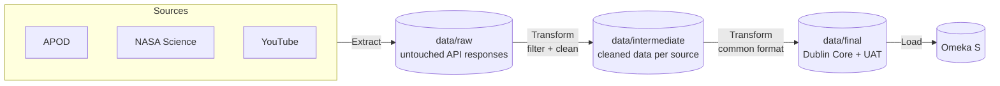

# biblioteca_digital_astronomia

Proyecto GRD 2026 — *Gestión de Recursos Digitales*, Universidad de Granada.

A digital library that brings together astronomy resources published online by NASA
and makes them searchable in a single repository built with **Omeka S**.

| Resource type | Source |
|---|---|
| Astronomical images | [APOD Archives (NASA)](https://apod.nasa.gov/apod/archivepix.html) |
| Popular science articles | [NASA Science](https://science.nasa.gov) |
| Explanatory videos | [NASA YouTube](https://www.youtube.com/@NASA) |

Every resource is described with Dublin Core metadata, always links back to its original
source, and is annotated with the [Unified Astronomy Thesaurus (UAT)](https://astrothesaurus.org).

---

## How it works (ETL)

The repository is filled automatically by an **ETL** pipeline (Extract → Transform → Load):

| Step | What it does | Output |
|---|---|---|
| **Extract** | Retrieves the resources from each source (APIs) and saves the response untouched | `data/raw/` |
| **Transform** (1) | Filters and cleans the data of each source | `data/intermediate/` |
| **Transform** (2) | Maps every source to the same final format (Dublin Core + UAT subjects) | `data/final/` |
| **Load** | Creates the items in Omeka S through its REST API | Omeka S |

Each source has its own *extract* and *transform* script, and the same file name at
every step (e.g. `data/raw/youtube.json` → `data/intermediate/youtube.json` →
`data/final/youtube.json`). The *load* step is shared, because all sources end in the
same final format.

---

## ETL architecture



## Project structure

```
biblioteca_digital_astronomia/
├── src/
│   ├── main.py                 # Entry point: runs the whole ETL
│   ├── utils.py                # JSON helpers
│   ├── extract/                # One file per source (raw API responses)
│   │   ├── youtube.py          # YouTube (@NASA channel)
│   │   ├── nasa_science.py     # NASA Science
│   │   └── apod.py             # APOD (planned)
│   ├── transform/              # One file per source (raw → intermediate → final)
│   │   ├── youtube.py
│   │   └── nasa_science.py
│   └── load/
│       └── omeka.py            # Sends items to Omeka S (planned)
├── data/
│   ├── raw/                    # Untouched API responses
│   ├── intermediate/           # Cleaned data per source
│   └── final/                  # Common format, ready for Omeka
├── .env                        # API keys (not versioned)
├── .gitignore
├── pyproject.toml
├── uv.lock
└── README.md
```

---

## Getting started

### 1. Requirements

- [uv](https://docs.astral.sh/uv/) (Python package and project manager)

Install uv on Windows (PowerShell):

```powershell
powershell -ExecutionPolicy ByPass -c "irm https://astral.sh/uv/install.ps1 | iex"
```

Install uv on macOS / Linux:

```bash
curl -LsSf https://astral.sh/uv/install.sh | sh
```

### 2. Install the dependencies

From the project root:

```bash
uv sync
```

This creates the virtual environment (`.venv`) and installs every dependency listed in
`pyproject.toml`, with the exact versions from `uv.lock`.

### 3. Add your API keys

Create a `.env` file at the project root:

```
YT_API_KEY=your_youtube_data_api_v3_key
```

> ⚠️ Never commit the `.env` file. It is already listed in `.gitignore`.

How to get a YouTube key: [Google Cloud Console](https://console.cloud.google.com)
→ create a project → enable **YouTube Data API v3** → *Credentials* → *Create API key*.

### 4. Run the project

```bash
uv run src/main.py
```

---

## Code quality

The project uses [Ruff](https://docs.astral.sh/ruff/) (linter and formatter) and
[mypy](https://mypy-lang.org/) (type checker), installed as development dependencies.

```bash
uv run ruff check .          # find problems
uv run ruff check . --fix    # fix them automatically when possible
uv run ruff format .         # format the code
uv run mypy src              # check types
```

Please run these commands before every commit.

---

## Useful uv commands

| Command | Description |
|---|---|
| `uv sync` | Install / update the dependencies |
| `uv add <package>` | Add a dependency to the project |
| `uv add --dev <package>` | Add a development dependency |
| `uv run <file.py>` | Run a script inside the project environment |